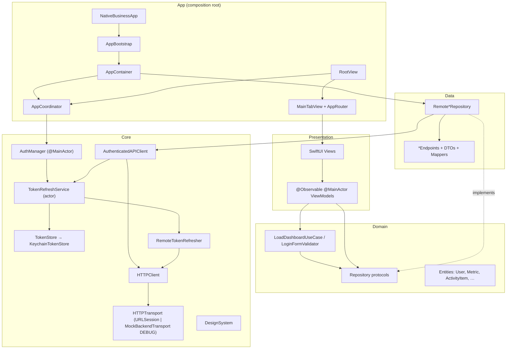
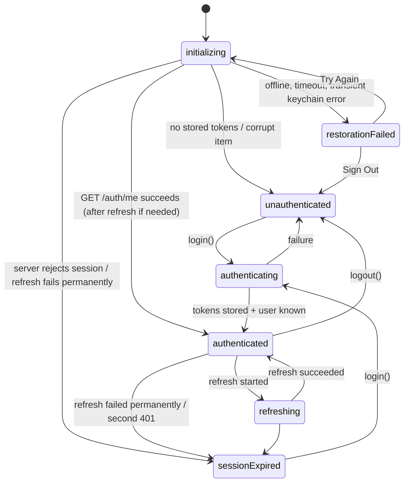

# Architecture

Feature-based Clean Architecture with MVVM, in a single app module. Layer boundaries are logical
(folders, dependency direction, protocols at the seams). Splitting them into Swift packages later
is possible but not required at this size.

## Diagram



## Layers and feature boundaries

| Layer | Contains | May depend on |
| --- | --- | --- |
| **Presentation** (`Features/*/Presentation`) | SwiftUI views, `@Observable` view models, display mapping | Domain, Core (design system, utilities) |
| **Domain** (`Features/*/Domain`, `Core/SharedDomain`) | Entities, repository protocols, use cases, validation | Foundation only, never SwiftUI |
| **Data** (`Features/*/Data`) | DTOs, endpoint definitions, mappers, `Remote*Repository` | Domain, Core networking |
| **Core** | Networking, session management, Keychain, logging, design system, utilities | Foundation/SwiftUI/Security |
| **App** | Composition root, configuration, coordinator, router, root views | Everything |

Each feature (`Authentication`, `Home`, `Analytics`, `Notifications`, `Profile`) owns its DTOs and
endpoints, so a backend change to one feature stays inside its `Data` folder.

`Core/Authentication` holds the session contracts (`AuthRepository`, `TokenRefreshing`, `User`,
`AuthTokens`, `AuthState`) because the session is cross-cutting. `Features/Authentication`
provides their implementations and the login UI.

## MVVM responsibilities

- **Views** render state and forward user intent. They never perform I/O, never build requests and
  never construct services. They receive view models from `AppContainer` factories.
- **ViewModels** (`@MainActor @Observable final class`) hold UI state (`LoadState`, field errors,
  flags), call repositories or use cases, and map errors to `UserFacingError`. They never touch
  `URLRequest`.
- **Use cases** exist only where they add behaviour: `LoadDashboardUseCase` loads independent
  sections concurrently and returns per-section `Result`s. `LoginFormValidator` is pure validation.
  Thin pass-through use cases were intentionally not added.
- **Repositories** translate between DTOs and domain entities and hide endpoints.

## Data flow (Home dashboard)

1. `HomeView.task` calls `HomeViewModel.loadIfNeeded()` (the task is cancelled if the view disappears).
2. `LoadDashboardUseCase` runs `fetchSummary()` and `fetchRecentActivity()` concurrently with `async let`.
3. `RemoteDashboardRepository` → `AuthenticatedAPIClient.send(endpoint)`:
   - obtains a token from `TokenRefreshService` (refreshing proactively if known to be expired),
   - `HTTPClient` builds the request (`RequestBuilder`), sends it via `HTTPTransport`, validates
     the status, applies bounded retry, and decodes (`JSONCoding`, `LossyArray`),
   - on `401`: one coalesced refresh, one retry, then the session ends.
4. DTOs are mapped to entities (`DashboardMapper`). Each section becomes `.loaded`, `.empty` or
   `.failed(UserFacingError)`. A failed refresh keeps existing content and shows a banner.
5. SwiftUI re-renders through Observation.

## Dependency injection

`AppContainer` (`App/AppContainer.swift`) is the only place where concrete types are created:

```
APIConfiguration ─► HTTPClient(transport) ─┬─► RemoteTokenRefresher ─► TokenRefreshService(TokenStore)
                                           └─► AuthenticatedAPIClient(tokenProvider: TokenRefreshService)
AuthenticatedAPIClient ─► Remote{Auth,Dashboard,Analytics,Notifications,Profile}Repository
RemoteAuthRepository + TokenRefreshService ─► AuthManager ─► AppCoordinator
make*ViewModel() factories ─► views
```

`AppBootstrap.make()` picks the variant:

| Mode | Transport | Token store |
| --- | --- | --- |
| Production / normal debug run | `URLSession` (`.api` ephemeral configuration) | `KeychainTokenStore` |
| `-demo-mode` / `-ui-testing` (DEBUG only) | `MockBackendTransport` | `InMemoryTokenStore` |
| Hosting unit tests | none (the app renders an empty view) | none |

Tests build their own graphs from the same initialisers with stubs. There are no singletons or
service locators. The only process-wide state is `os.Logger` categories.

`@Environment` carries `AppRouter` (tab/path navigation) and `AppFormatters` (locale-aware formatting).

## Authentication lifecycle



`AppCoordinator.route` is a pure function of `AuthManager.state`, the single source of truth:
`.launching`, `.login(notice)`, `.main(user)` or `.restorationFailed(error)`. Because all state
changes happen on the main actor and every session change bumps a generation counter, a slow
operation from an old session (such as a restore finishing after logout) cannot overwrite a newer state.

The authenticated shell is keyed by user id, and its router and view models are created per
session, so no navigation or data leaks between users.

## Concurrency model

- UI state: `@MainActor` view models, `AuthManager`, `AppRouter`, `AppCoordinator`.
- Shared mutable session state: `TokenRefreshService` is an `actor`.
- Stateless services (`HTTPClient`, `KeychainTokenStore`, repositories) are `Sendable` value types or
  immutable final classes.
- Test doubles use `Synchronization.Mutex`. The app sources contain no `@unchecked Sendable` and no
  `nonisolated(unsafe)`.
- Build settings: Swift 6 language mode, `SWIFT_STRICT_CONCURRENCY = complete`. The app builds with
  zero Swift warnings.
